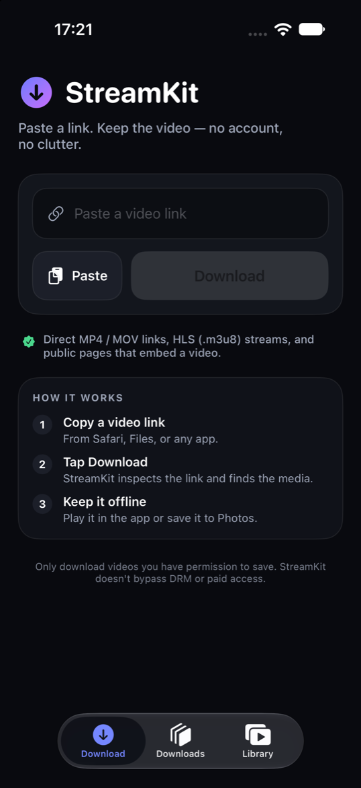
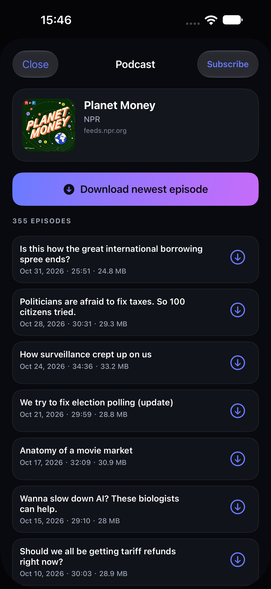

# FluxKit

A no-account, offline media saver for iOS: **HLS playlists, direct links, and podcast feeds**.
Paste a link (or share one from Safari), tap **Download**, keep it offline. Built with SwiftUI,
AVFoundation and URLSession. The only third-party package is RevenueCat (subscriptions).

[](https://github.com/pwy19831104/fluxkit/actions/workflows/ci.yml)

<p align="center">
  
  
</p>

**Positioning:** FluxKit is for media you are allowed to keep — your own CDN/S3 links, HLS
deliverables, course replays, self-hosted streams, and public podcast feeds. It is *not* a
platform ripper: DRM, logins, paywalls, and platform-locked links are deliberately out of scope.
See [`docs/POSITIONING.md`](docs/POSITIONING.md) for the rationale and ASO plan, and
`fastlane/metadata/` for the store copy.

## What it does

- **Paste → download.** Accepts direct media links (`mp4`, `mov`, `webm`, `mp3`, `m4a`, …) and HLS
  streams (`.m3u8`).
- **Podcasts.** Paste an RSS/Atom feed URL and get an episode picker with dates, durations and
  file sizes; the newest episode is one tap away. Subscribe to keep shows in a **Podcasts** tab,
  import/export subscriptions as OPML, and optionally auto-download the newest 1/3/5 episodes.
  Only the public enclosure URL is read.
- **Paste anything.** Share sheets rarely copy a clean URL — apps often copy a blurb like
  `看看这个视频 5.33 复制打开 https://cdn.example.com/clip.mp4 挺好的`. The paste button and the
  share extension both run `LinkTextExtractor` first, so the link is pulled out of the text and
  the field is cleaned up before resolving. `LinkURL` then rejects anything that is not
  `http`/`https` (`mailto:`, `file:`, `ftp:`, bare phone numbers, …).
- **No clipboard snooping.** The app never reads the clipboard on its own. A link goes in only
  when you tap **Paste** (or share from another app), so nothing pops in uninvited.
- **Finds the media on a page.** If you paste a normal web page, the app scrapes
  `og:video`, `twitter:player:stream`, `<video>`, `<source>`, `<link rel="…" type="video/…">`
  and JSON-LD `contentUrl` candidates, then probes the winner's `Content-Type`.
- **HLS pipeline.** Master playlist → best variant → parallel segment download (6 at a time) →
  AES-128 segment decryption → fMP4 passthrough or MPEG-TS remux to `.mp4`. Separate audio
  renditions are muxed back with `AVMutableComposition`.
- **Downloads survive the app.** Progressive transfers run on a background `URLSession`, so they
  keep going while the app is suspended or terminated, and are re-matched after a relaunch via
  `taskDescription`. HLS jobs write each finished segment to disk, so pause, crash, or relaunch
  resumes from the last segment instead of starting over. Progressive pause/resume uses the
  system's resume data (byte-exact).
- **Queue + Wi-Fi rule.** Choose 1–4 concurrent downloads; the rest queue and start automatically.
  Wi-Fi-only holds tasks (and shows why) until the network is right.
- **Background audio.** Playback keeps running with the screen locked: `AVAudioSession(.playback)`,
  `UIBackgroundModes: audio`, lock-screen metadata, remote play/pause/seek, playback speed
  (0.75×–2×) and resume-where-you-stopped.
- **Library tools.** Search, sort (newest/oldest/largest/title), multi-select delete, storage
  totals, and podcast artwork saved with the download.
- **Subtitles & Picture in Picture.** Embedded subtitle/audio tracks can be selected from the CC
  menu; HLS subtitle renditions are downloaded next to the video as WebVTT and rendered as an
  overlay. Video can continue in a Picture-in-Picture window with lock-screen controls.
- **FluxKit Pro (optional).** StoreKit 2 auto-renewable subscriptions managed through
  **RevenueCat** unlock 4-at-once downloads and podcast auto-download; the core downloader stays
  free. See [`docs/PRO.md`](docs/PRO.md) for the RevenueCat/ASC setup.
- **Files app.** Downloads live in **On My iPhone → FluxKit → Media**, are named after their
  titles, and can be imported back with **Import from Files** in the library.
- **Play queue & listened progress.** Opening an item builds a queue from the list you were in;
  previous/next buttons (and auto-advance at the end) work for videos and podcast episodes.
  Cards show a progress bar, “Resume”, or “Played”, backed by persisted `lastPosition`/`played`.
- **Opt-in notifications.** A local notification when a background download finishes or fails.
- **Share sheet.** Share any link from Safari/YouTube-free sources straight into the app; the
  extension drops it into an App Group inbox and the app picks it up on next activation.
- **Play offline.** Built-in `AVPlayer`, share sheet, and *Save to Photos*.
- **Library.** Local JSON index in Application Support, thumbnails, size/duration, delete, retry.
- **Deep link.** `fluxkit://open?url=<percent-encoded link>` lets Shortcuts or a
  share-sheet shortcut hand a URL over without retyping.
- **Ads (off by default).** `SponsorSlot` reserves space on Home, Downloads and Library, but
  `AdsConfig.isEnabled` is `false` and no SDK is linked. See
  [`docs/ADS.md`](docs/ADS.md) for placement rationale, AdMob integration and the ATT/UMP
  compliance checklist.

## Supported links (and why some are blocked)

**Works:** direct media links (`mp4`, `mov`, `webm`, `m4a`, `mp3`, …), HLS playlists (`.m3u8`),
podcast RSS/Atom feeds, and public web pages that expose `og:video`, `<video>`, `<source>` or
JSON-LD `contentUrl`.

**Blocked on purpose:** Douyin, TikTok, YouTube, Instagram, Facebook, X, Kuaishou, Xiaohongshu,
Bilibili, Netflix. These services hand out short-lived, signed playback URLs through an API that
expects their own app/session; the share page itself contains no media URL. FluxKit checks the
link before downloading, so it fails fast with a clear message instead of saving an HTML page.
Supporting them would require a server-side extractor (and rewriting their request signatures),
which is out of scope and breaks whenever they change the API. See
[`docs/FAQ.md`](docs/FAQ.md).

## Language

Two languages ship in the binary. The **default** comes from the region, not from the device's
language list: mainland China (`Locale.current.region == CN`) gets Simplified Chinese, every other
region gets English. The globe button on the home screen switches between **English** and
**中文** at any time; the manual pick always wins over the region and is remembered.

- Resolution: `AppLanguage.effective(regionIdentifier:override:)` — one pure function, unit-tested.
- Storage: `LanguagePreferences` writes `fluxkit.language.override` into the App Group defaults,
  so the share extension renders in the same language as the app.
- Copy: a two-string lookup `L("English", "中文")` (`Shared/AppLanguage.swift`); no `.lproj` files.
- Switching rebuilds the tab content (`RootView` applies `.id(language)`), so every label updates
  immediately. Scroll position and the untouched link field reset when you switch.
- Debug builds accept `SIMCTL_CHILD_APP_LANGUAGE=zh|en` (render only) and
  `SIMCTL_CHILD_SET_LANGUAGE=zh-Hans|en` (goes through the real switcher and persists).

## Requirements

- Xcode 26 or newer, iOS 17+ deployment target
- [XcodeGen](https://github.com/yonaskolb/XcodeGen) (`brew install xcodegen`) — the project file is generated
- An App Group named `group.cloud.fluxkit.app` registered for both bundle ids when you build for a device

## Signing

`project.yml` pins the development team for every target (app, share extension, tests):

```yaml
DEVELOPMENT_TEAM: H5YQ9HSATA
```

That team already owns `cloud.fluxkit.app`, `cloud.fluxkit.app.share` and
`group.cloud.fluxkit.app`. If you publish under a different team:

1. Change the one `DEVELOPMENT_TEAM` line in `project.yml`.
2. Regenerate the project: `xcodegen generate` (XcodeGen owns the `.xcodeproj`, so
   picking a team in Xcode's Signing editor is overwritten on the next generate).
3. In the developer portal, make sure both App IDs have the **App Groups** capability
   with `group.cloud.fluxkit.app`, and that your account is signed into
   Xcode → Settings → Accounts.
4. Build once with `xcodebuild ... -allowProvisioningUpdates` or with Xcode open so the
   development profiles get refreshed.

Verify a device build with:

```bash
codesign -dv --verbose=2 "$(xcodebuild -showBuildSettings | awk -F' = ' '/ BUILT_PRODUCTS_DIR/{print $2; exit}')/FluxKit.app"
```

It should print `TeamIdentifier=H5YQ9HSATA`.

Archive and export an App Store build:

```bash
xcodebuild -project FluxKit.xcodeproj -scheme FluxKit -configuration Release \
  -destination 'generic/platform=iOS' -archivePath build/FluxKit.xcarchive \
  archive -allowProvisioningUpdates

xcodebuild -exportArchive -archivePath build/FluxKit.xcarchive \
  -exportPath build/export -exportOptionsPlist ExportOptions.plist \
  -allowProvisioningUpdates
```

`build/export/FluxKit.ipa` is then ready for Transporter / App Store Connect.

## Run it

```bash
xcodegen generate
open FluxKit.xcodeproj
```

Command line:

```bash
xcodebuild -project FluxKit.xcodeproj -scheme FluxKit \
  -sdk iphonesimulator -destination 'platform=iOS Simulator,name=iPhone 17' build

xcodebuild test -project FluxKit.xcodeproj -scheme FluxKit \
  -sdk iphonesimulator -destination 'platform=iOS Simulator,name=iPhone 17'
```

The project has two app targets: `FluxKit` (the app) and `FluxKitShare` (share
extension, embedded in `PlugIns/`).

## How a link is resolved

```
input ──► normalize (https://, validation)
          │
          ├─ HEAD / ranged GET probe ──► video/*, audio/*  ──► progressive download
          │                          └─ mpegurl / .m3u8 ──► HLS pipeline
          │
          └─ text/html ──► scrape candidates ──► probe ──► media
```

Downloads land in `Application Support/FluxKit/Media`, thumbnails next to them in
`…/Thumbnails`, pending resume data as `…/Media/<record-id>.resume`, and the index in
`…/library.json`.

## Lifecycle notes

- **Progressive downloads** use `URLSessionConfiguration.background(withIdentifier:)` with
  `sessionSendsLaunchEvents`. `AppDelegate` forwards
  `handleEventsForBackgroundURLSession` to `BackgroundSessionBridge`, and
  `urlSessionDidFinishEvents(forBackgroundURLSession:)` calls it back — otherwise iOS kills the
  app for stalling background work.
- **Relaunch reconciliation:** `DownloadManager.reconcileWithSystem()` asks the system for live
  tasks and marks anything still "running" in the index as paused (resume data present) or
  interrupted (no data). Task identity travels in `taskDescription` (`<uuid>|<ext>`), because
  `taskIdentifier`s are not stable across launches.
- **HLS downloads** are orchestrated in-process (parallel segments + remux), so they pause when
  the app is suspended. Resume data doesn't apply to them.

## Layout

```
Sources/
  App/        entry point + app delegate (background session events)
  Core/       models + on-disk paths
  Services/   LinkResolver, DownloadManager, HLSDownloader, LibraryStore, thumbnails, Photos
  Views/      Home, Downloads, Library, Player, preview sheet, theme
  Debug/      DEBUG-only smoke test harness
Shared/       SharedInbox (App Group mailbox), LinkURL + LinkTextExtractor (compiled into app + extension)
ShareExtension/
              ShareViewController (share sheet UI + link extraction)
Tests/        resolver, model, HLS and deep-link unit tests
UITests/      XCUITests (home, settings, library, paywall, pro state)
docs/         positioning, roadmap, pro setup, store copy, legal pages
site/         generated static pages for openkit.cloud (see docs/HOSTING.md)
project.yml   XcodeGen spec (Info.plists + entitlements are generated from it)
```

## Debug hooks (DEBUG builds only)

```bash
# Resolve + download a list of links, logging outcomes to the unified log
SIMCTL_CHILD_SMOKE_URLS="https://example.com/a.mp4" \
  xcrun simctl launch --console booted cloud.fluxkit.app --smoke-test

# Same, but pause after 3 s and resume 1.5 s later (exercises resume data)
SIMCTL_CHILD_SMOKE_PAUSE=1 SIMCTL_CHILD_SMOKE_URLS="…" \
  xcrun simctl launch booted cloud.fluxkit.app --smoke-test

# Simulate the share extension writing into the App Group
SIMCTL_CHILD_INBOX_PUSH="https://example.com/page" xcrun simctl launch booted cloud.fluxkit.app

# Pre-fill the field and open the preview sheet / start on a tab
SIMCTL_CHILD_PREVIEW_URL="…" SIMCTL_CHILD_SHOW_TAB=library xcrun simctl launch booted cloud.fluxkit.app

# Flip the in-app language switch (persisted, same path as the globe menu)
SIMCTL_CHILD_SET_LANGUAGE=zh-Hans xcrun simctl launch booted cloud.fluxkit.app
```

## Scope and limitations

- **Platform lock-in is deliberate.** YouTube, TikTok, Instagram and similar services sign
  their media URLs and protect them with DRM; downloading them requires a server-side
  extractor and violates their terms. This app only handles links it can resolve over plain
  HTTP, and it never bypasses DRM or paywalls. Known page hosts (Douyin, TikTok, YouTube,
  Instagram, Facebook, X, Kuaishou, Xiaohongshu, Bilibili, Netflix) are recognised up front and
  rejected with an explanation instead of “no video found” — direct CDN file URLs still work.
- **Simulator quirk:** `AVAssetExportSession` fails on the simulator (`AVFoundationErrorDomain -11800`).
  The concatenated stream is still saved (`.mp4` for fMP4, `.ts` for legacy TS) and the app
  falls back gracefully; verify remuxing on a physical device.
- Subtitle renditions are ignored; audio is muxed from the default rendition only.
- The share extension can't launch the app itself in most iOS versions; it saves the link and
  shows "Open FluxKit", which drains the inbox on activation.

## Before shipping to the App Store

- Bundle ids are `cloud.fluxkit.app` (app), `cloud.fluxkit.app.share` (extension) and
  `cloud.fluxkit.app.tests`. The App Group `group.cloud.fluxkit.app` and the team are already
  wired up in `project.yml` (`DEVELOPMENT_TEAM: H5YQ9HSATA`); change that one line if you publish
  under another team.
- App icon lives in `Sources/Resources/Assets.xcassets/AppIcon.appiconset` — regenerate with your brand.
- `NSAllowsArbitraryLoads` is enabled because users can supply `http://` media. Explain this in
  App Review notes; alternatively restrict to `NSAllowsArbitraryLoadsForMedia`.
- Guideline 5.2.3 (copyright) is the main rejection risk for downloader apps: keep the in-app
  notice ("only download content you have permission to save"), avoid naming third-party
  platforms in the metadata, and be ready to explain the DRM stance.
- Privacy: no analytics, no accounts, no network calls except the URLs the user provides.
  Subscriptions use RevenueCat for receipt validation (anonymous app user ID; no IDFA).
- Tests: 77 unit tests + 6 XCUITest flows (`make test`), covering parsing, WebVTT, settings,
  queue math, pro gating, import, library search, paywall and settings layout.
- CI: [`.github/workflows/ci.yml`](.github/workflows/ci.yml) generates the project, boots a
  simulator, runs unit + UI tests, and compiles a Release build.

See [`docs/ROADMAP.md`](docs/ROADMAP.md) for the feature status,
[`docs/LAUNCH_GUIDE.md`](docs/LAUNCH_GUIDE.md) for the step-by-step App Store Connect +
RevenueCat launch checklist, and [`docs/HOSTING.md`](docs/HOSTING.md) for publishing the
privacy policy / terms / support pages (`make site`).
